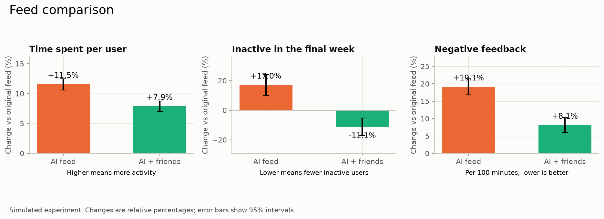

# Social Feed Experiment

Which feed keeps people engaged and coming back?

This project compares an original feed, an AI-recommended feed, and an AI feed that gives
more priority to friends' posts. It uses **60,000 simulated users** and a **28-day experiment**
to turn a set of results into a launch recommendation.



## What I found

Changes below are relative to the original feed.

| Measure | AI feed | AI + friend boost |
|---|---:|---:|
| Time spent per user | +11.5% | +7.9% |
| Inactive during the final week | +17.0% | -11.1% |
| Negative feedback per 100 minutes | +19.1% | +8.1% |

**Recommendation:** consider a limited rollout of friend boost after addressing negative
feedback. It increased activity and reduced inactivity, but it still needs improvement.

The analysis also checks whether the initial gains fade, which age groups are affected,
and whether personalized feed assignment improves the decision.

## Start here

- [Short project report](reports/EXECUTIVE_MEMO.md): results, recommendation, and limitations.
- [Three charts to walk through](reports/CHART_GUIDE.md): the result, the trend, and the audience.
- [Technical reference](docs/technical-reference.md): methods, checks, and the full project structure.
- [Detailed results](reports/TECHNICAL_REPORT.md): statistical comparisons and additional analyses.

## Run it

```bash
make setup
make all
make dashboard
```

Python 3.12. The dashboard runs in Streamlit. [Power BI files](powerbi/README.md) are also included.

## Tools

Python, pandas, SQL/DuckDB, scikit-learn, Plotly, Streamlit, and Power BI.

## Scope

The feed experiment is simulated. Separate sentiment and article-popularity examples use
real public data. Financial estimates are scenarios based on assumptions, not realized
revenue. The decision thresholds were chosen after the first analysis; a new experiment
should define them in advance.

Analysis code is in `sei/`, charts and result tables are in `reports/`, and automated checks
are in `tests/`.
