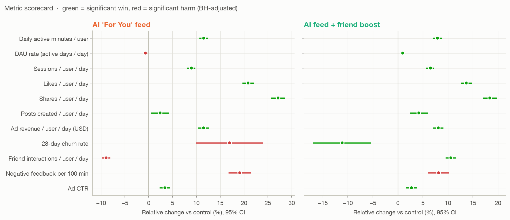
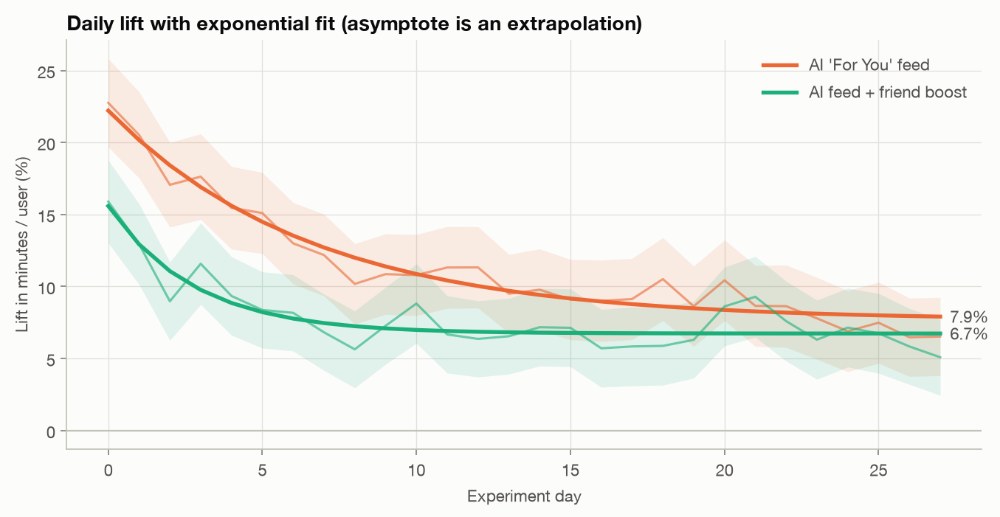
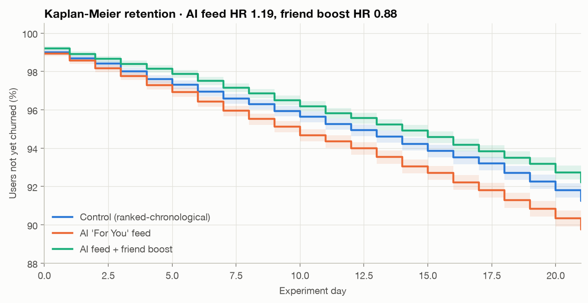
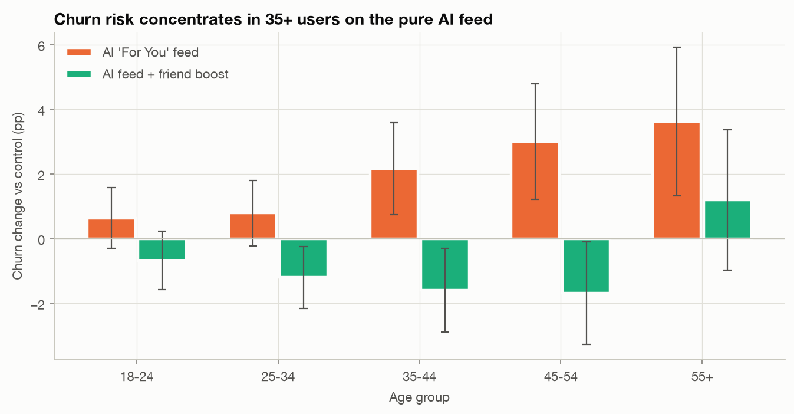
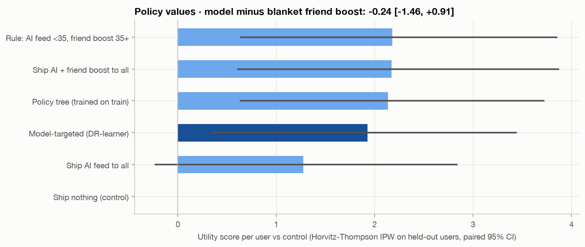
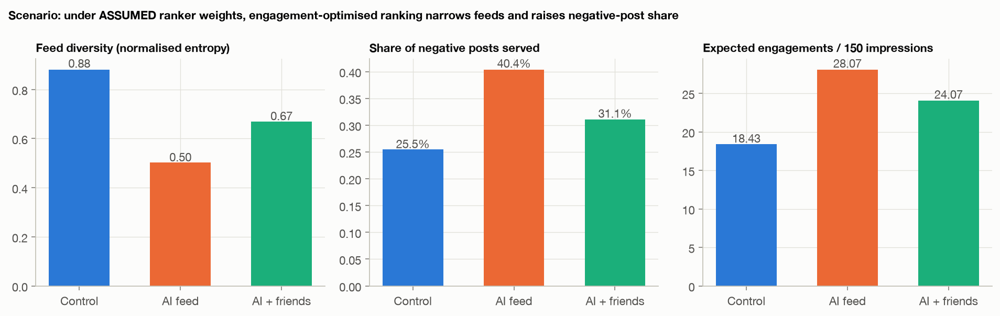
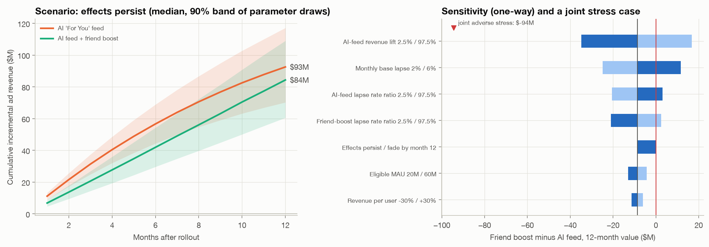

# Social Engagement Intelligence: Experimentation, Causal ML & Retention Analytics

> **Synthetic data.** The experiment is simulated (`sei/simulate.py`); only the NLP and virality modules use real public
> data. Numbers illustrate methods, not a real product. An independent audit ([`docs/AUDIT_2026-10-25.md`](docs/AUDIT_2026-10-25.md))
> found 16 issues in an earlier version; every one is addressed in [`docs/AUDIT_RESPONSE_2026-10-25.md`](docs/AUDIT_RESPONSE_2026-10-25.md),
> and several headline results changed as a result.

**Business question.** A social app tested two AI-ranked feeds against its current feed on 60,000 users for 28 days.
The pure AI "For You" feed has the biggest headline lift. Should we ship it?

**Answer, generated by a written decision rule ([`sei/decision.py`](sei/decision.py)):**

- **Pure AI feed: do not launch.** It fails the critical churn guardrail (+17% final-week inactivity), plus friend
  interactions (−9%) and negative feedback (+19%).
- **AI feed + friend boost: conditional launch.** It wins on the primary metric (+7.9% minutes), passes churn (−11%) and
  friend interactions (+11%), but **fails the negative-feedback guardrail (+8.1% vs a 5% margin)**. It ships only with a
  named mitigation and a guardrail monitor on the ramp.
- **12-month ad revenue does not separate the two variants.** Friend boost minus AI feed is −$9M (90% of draws −$32M to
  +$14M) if effects persist. The decision rests on the guardrails, not on revenue.
- **Personalized assignment does not beat a blanket friend-boost launch** (−0.24 utility/user, 95% CI −1.46 to +0.91),
  and the causal models recover individual effects only weakly when checked against simulator counterfactuals.



---

## What's inside

| Module | Methods | Key result |
|---|---|---|
| **Simulation engine** (`sei/simulate.py`) | 42-day user-level event log, latent-trait heterogeneous effects, AR(1) behavior, novelty decay, emergent churn hazard, salted-hash assignment | 1.76M active user-days; pre/post correlation 0.82 |
| **Experiment design** (`sei/experiment.py`) | SRM χ², covariate SMD balance, A/A re-randomization, power/MDE | SRM p = 0.10 · max \|SMD\| 0.019 · A/A FPR 5.1% |
| **Effect estimation** | Welch-SE z-tests + **CUPED** (relative lift on the raw control mean, dependence-aware delta method), **delta method** for ratio metrics, Poisson-bootstrap quantiles, Benjamini-Hochberg & Holm | CUPED removes ~68% of variance (MDE 2.1% → 1.2%) |
| **Decision rule** (`sei/decision.py`) | Guardrail non-inferiority margins, Bonferroni across guardrails × arms, LAUNCH / CONDITIONAL / DO NOT LAUNCH states | Friend boost CONDITIONAL; AI feed DO NOT LAUNCH |
| **Time dynamics** | Daily lift, exponential fit with user-bootstrap intervals; mixture-SPRT monitoring with a pre-period prior and a null diagnostic on the real design | Fitted asymptote +7.7% (CI 5.4–9.3%), ~66% of the headline lift; peeking 13.0% vs mixture 1.8% false positives |
| **Segments & HTE** (`sei/hte.py`, `sei/oracle.py`) | Segment CUPED effects (BH), interaction OLS (HC1), T- and cross-fitted DR-learner, uplift gain curves, **validation against simulator counterfactuals** (16 common-seed re-simulations per user) | Churn harm in 35+ (interaction p = 0.0025); CATE Spearman vs oracle 0.19 / 0.08 |
| **Policy evaluation** | 3-arm policies valued with Horvitz-Thompson IPW (known 1/3 design), paired bootstrap differences, oracle regret, surrogate tree trained on train only | No policy beats blanket friend boost |
| **Retention** (`sei/retention.py`) | Time to first 7-day lapse (consistent censoring), KM, log-rank, Cox PH + PH test, RMST, rate ratios; lapse early-warning among users **active on the scoring day**; campaign depth frozen on training data with a no-send option | HR 1.08 / 0.91 · deployed logistic AUC 0.791, top-decile lift 4.5× · nudge $1.50M (CI 1.12–1.89) under an assumed save rate |
| **NLP on real text** (`sei/nlp.py`) | TweetEval: TF-IDF word+char LogReg vs VADER on official splits; NMF topics; ranker-exposure **scenario** on held-out posts with a weight sweep | Macro-recall 0.628 vs 0.570; negative-share 25–49% depending only on assumed weights |
| **Virality on real data** (`sei/virality.py`) | UCI news (39,644 articles), whole-date split, training-only threshold, ablation without unverifiable share features | AUC 0.731; 0.691 without share-history features |
| **Revenue scenarios** (`sei/impact.py`) | Revenue per not-lapsed user-day × lapse survival, joint bootstrap with shared control, persistence scenarios, one-way + joint stress | Variants indistinguishable on revenue; joint stress −$94M |
| **Executive memo** (`sei/report.py`, `sei/narrative.py`) | Every sentence derived from results + decision rule; optional Claude API brief | [`reports/EXECUTIVE_MEMO.md`](reports/EXECUTIVE_MEMO.md) |
| **Dashboards** | Streamlit (9 pages) + **Power BI PBIP** (9 pages, 30 DAX measures, Fabric deploy notebook) | [`dashboard/`](dashboard/app.py) · [`powerbi/`](powerbi/README.md) |
| **Engineering** | `make fixture` / CI runs the whole pipeline on a 3,000-user fixture in a scratch dir; run manifest with commit, versions, input/output hashes; 31 tests incl. audit regressions | [`.github/workflows/ci.yml`](.github/workflows/ci.yml) |

## What v2 fixes from the original project

| Issue in [v1](https://github.com/sakshiraade/social-engagement-intelligence) | v2 |
|---|---|
| One row per user; pre and post metrics drawn independently, so CUPED is impossible | Daily event log with autocorrelated behavior; CUPED removes ~68% of variance |
| `days_since_last_login` generated **from the churn label**, then used as a model feature | Point-in-time features (≤ day 13), a future label window and a scoring cohort with nobody already gone; tests perturb the future and check features don't change |
| "Experiment week" randomly assigned per user, so novelty can't really be measured | Real calendar time: daily lift with a fitted decay and bootstrap intervals |
| 15 caption templates repeated 50K times as the NLP corpus | 60K real human-labeled tweets with official splits and a published benchmark |
| Two arms, fixed-horizon t-tests only | Three arms, delta method, sequential monitoring, Bayesian summaries, multiple-testing control, a written decision rule |
| Segment cuts only | Causal ML validated against simulator counterfactuals, off-policy evaluation, paired policy comparisons |
| Notebooks only, no tests | Importable package, one-command pipeline, CI on a fixture, 31 tests |

## Selected figures

| | |
|---|---|
|  |  |
|  |  |
|  |  |

All 17 figures are in [`reports/figures/`](reports/figures), all result tables in [`reports/tables/`](reports/tables).

## Quickstart

```bash
make setup        # venv + pinned versions from requirements-lock.txt (Python 3.12)
make all          # download data → run pipeline (~7 min) → run tests
make fixture      # the same pipeline on a 3,000-user fixture in a scratch dir (what CI runs)
make dashboard    # streamlit run dashboard/app.py
```

Individual modules run on their own: `python -m sei.experiment`, `python -m sei.hte`, and so on.
`python -m sei.pipeline --llm` also writes a Claude-polished executive brief (`claude-opus-5-5`). It uses the
`ANTHROPIC_API_KEY` or `ant auth login` credentials, and is skipped gracefully when neither is present.

**Power BI:** see [`powerbi/README.md`](powerbi/README.md). The semantic model reads its CSVs straight from this
GitHub repo. In a Fabric workspace, import and run `powerbi/deploy_to_fabric.ipynb` (creates or updates the model and
report); on Windows, open `powerbi/SEI_Dashboard.pbip` in Power BI Desktop. The DAX was checked statically (field references,
filters, control baselines that clear arm filters), not executed in a live Power BI engine.

## Explore the data yourself

| Way | Command / file | Best for |
|---|---|---|
| **SQL prompt** | `make sql` → type queries ending in `;` (`.tables` lists all 72 tables) | quick questions |
| **Example queries** | `make examples` runs [`queries/examples.sql`](queries/examples.sql) (14 annotated queries) | learning the schema |
| **Notebook** | [`notebooks/explore.ipynb`](notebooks/explore.ipynb): SQL + pandas + Plotly + a one-line CUPED `ab_test()` on any metric/segment | your own analysis |
| **One-off** | `.venv/bin/python -m sei.sql "SELECT arm, AVG(churned) FROM user_experiment GROUP BY arm"` | scripting |
| **Power BI** | Fabric report, or *Explore* / *DAX query view* on the semantic model | business users |

Key tables: `users`, `daily_activity` (event log), `user_experiment` (one row per user, pre/exp/late metrics),
`churn_scores`, `user_cate`, plus every result table in `reports/tables/`.

## Project layout

```
sei/                 analysis package (config, simulate, features, stats, decision, experiment, oracle, hte,
                     retention, nlp, virality, impact, narrative, report, powerbi, pbi_report, sql, pipeline, download)
dashboard/app.py     Streamlit app
powerbi/             PBIP project + star-schema CSVs + DAX + theme
reports/             EXECUTIVE_MEMO.md, *_summary.json, figures/, tables/
tests/               statistical calibration, data-contract and audit-regression tests
docs/                independent audit and the response to each finding
data/                raw/ & processed/ (regenerated), external/ (downloaded)
```

## Data & honesty notes

- The experiment is **simulated**: no public dataset has randomized feed-ranking experiments with pre-period logs.
  Simulator latent traits and counterfactual re-simulations are used **only** to validate models, never as features.
- The NLP and virality modules use **real public data**: TweetEval sentiment (Barbieri et al., 2020;
  SemEval-2017) and UCI Online News Popularity (Fernandes et al., 2015, CC BY 4.0).
- Content exposure by arm is a **scenario**: the harms come from assumed ranker weights, shown with a sensitivity sweep.
- Guardrail margins were written after the first analysis had been seen; a real program fixes them before unblinding.
- Business figures (40M MAU, $38 user value, 3.5% monthly base lapse rate, 18% nudge save rate) are assumptions in
  `sei/config.py`; revenue outputs are scenarios, and "share of draws" is not an empirical probability.
