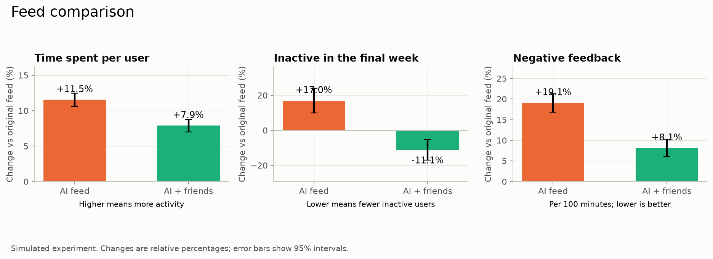

# Social Feed Experiment

> SYNTHETIC DATA: the experiment is simulated (sei/simulate.py); only the NLP and virality modules use real public data. Numbers illustrate methods, not a real product.

## The question

Which feed increases activity while supporting continued participation?

The comparison uses 60,000 simulated users, 14 days of prior activity,
and a 28-day experiment. The original feed is the comparison group.

## What changed

| Measure, relative to the original feed | AI feed | AI + friend boost |
|---|---:|---:|
| Time spent per user | +11.5% | +7.9% |
| Inactive during the final week | +17.0% | -11.1% |
| Interactions with friends | -8.9% | +10.6% |
| Negative feedback per 100 minutes | +19.1% | +8.1% |

## Recommendation: CONDITIONAL

Consider a limited rollout of AI feed + friend boost after addressing negative feedback, with continued monitoring.

The pure AI feed increased activity but also increased inactivity. Friend boost offered
a better balance, while negative feedback remained a concern.

## What I checked next

- **Over time:** the AI feed's activity improvement declined from 17.4%
  in week one to 7.5% in week four. Long-term fitted values are extrapolations.
- **Across people:** group-level comparisons show who was affected; they do not establish
  an individual person's response.
- **Personalized assignment:** the analysis did not demonstrate a gain over giving everyone friend boost.
- **Data and uncertainty:** allocation, prior behavior, and uncertainty were checked before interpreting the results.

## Limitations and next steps

This is a simulation. Inactivity is an observable seven-day lapse, not confirmed permanent departure.
The decision thresholds were chosen after seeing the initial analysis. A new experiment should
set its outcomes and thresholds in advance and retain a comparison group for longer follow-up.

Financial and content-ranking examples depend on assumptions. They are not observed revenue
or measured effects of a real platform.

[Chart guide](CHART_GUIDE.md) · [Full methods and results](TECHNICAL_REPORT.md)
